# Two-Site Enterprise Network with HSRP Redundancy

A headquarters (HQ) and branch network built in Cisco Packet Tracer. Two HQ routers share one virtual gateway with HSRP, three routers exchange routes with OSPF over two redundant WAN links, a DHCP relay serves the branch, and a DNS and web server is reachable from both sites. Failover was tested with a continuous ping while the active HQ router lost its WAN link.

## Topology

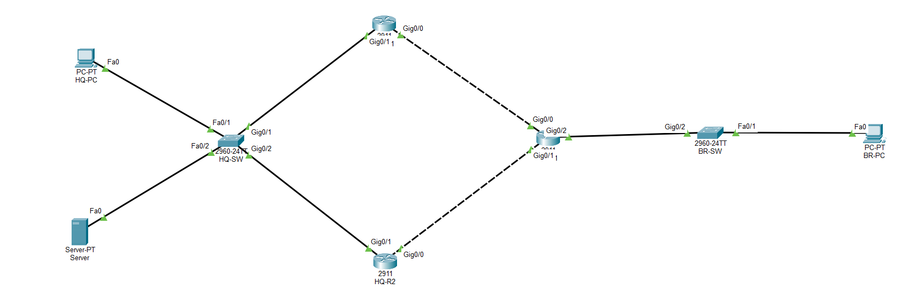

**Devices:** 3 routers (HQ-R1, HQ-R2, BR-R1), 2 switches (HQ-SW, BR-SW), 2 PCs (PC-HQ, PC-Branch), 1 server.

## Addressing plan

| Link / network | Subnet | Devices and ports |
|---|---|---|
| HQ-R1 to BR-R1 (WAN A) | 10.0.0.0/30 | HQ-R1 g0/0 = 10.0.0.1, BR-R1 g0/0 = 10.0.0.2 |
| HQ-R2 to BR-R1 (WAN B) | 10.0.1.0/30 | HQ-R2 g0/0 = 10.0.1.1, BR-R1 g0/1 = 10.0.1.2 |
| HQ LAN | 192.168.10.0/24 | HSRP virtual gateway 192.168.10.1, HQ-R1 g0/1 = .2, HQ-R2 g0/1 = .3, Server = .10 (static) |
| Branch LAN | 192.168.20.0/24 | BR-R1 g0/2 = 192.168.20.1 (gateway) |

PC-HQ and PC-Branch receive their addresses from DHCP. Both switches run on default settings, since the routers handle all routing (no VLANs or trunks are needed in this design).

## Technologies used
- OSPF (single area, Area 0) with passive LAN interfaces
- HSRP with preempt and interface tracking
- DHCP server on HQ-R1 with a DHCP relay (`ip helper-address`) on BR-R1
- DNS and HTTP services on the server
- Cisco Packet Tracer, Cisco IOS CLI

---

## Phase 1: Interface addressing

**Goal:** Give every router interface its address and bring the links up.

**What I configured:** IP addresses on all router ports (with `no shutdown`), /30 subnets on the two WAN links, and a static address and gateway (192.168.10.1) on the server.

**Verification:** `show ip interface brief` shows every used port up/up, and pings across both WAN links succeed.

(screenshots/02-ping-wan-link-2.png)

---

## Phase 2: OSPF routing

**Goal:** Let the three routers learn each other's networks automatically.

**What I configured:** OSPF process 1, Area 0, with router IDs 1.1.1.1 (HQ-R1), 2.2.2.2 (HQ-R2) and 3.3.3.3 (BR-R1). The LAN-facing ports are passive, and the WAN ports are not, so the routers form neighbors only over the WAN links.

**Verification:** BR-R1 lists both HQ routers as FULL neighbors and holds two equal-cost routes to the HQ LAN, one through each WAN link.

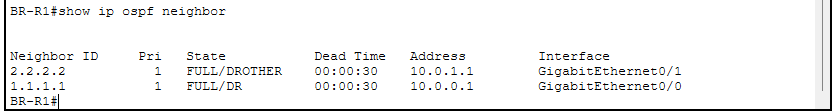
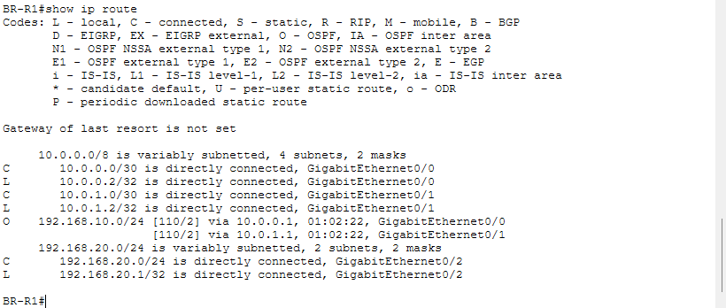

---

## Phase 3: HSRP gateway redundancy

**Goal:** Keep a working default gateway for the HQ LAN if one HQ router fails.

**What I configured:** HSRP group 1 on the HQ LAN ports with virtual IP 192.168.10.1. HQ-R1 has priority 110 (Active) and HQ-R2 has priority 100 (Standby), with `preempt` on both. On HQ-R1, tracking of its WAN port (g0/0) lowers its priority by 20 if that link goes down, so HQ-R2 takes over.

**Verification:** `show standby brief` shows HQ-R1 as Active and HQ-R2 as Standby on the same virtual IP.

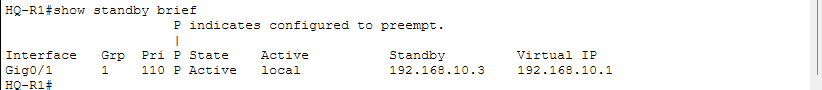
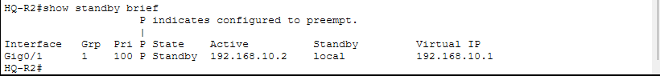

---

## Phase 4: DHCP and DHCP relay

**Goal:** Give both sites automatic addressing from a single DHCP server.

**What I configured:** On HQ-R1, two pools (HQ-LAN and BRANCH-LAN), each handing out its own default gateway and the DNS server 192.168.10.10, with the first ten addresses of each LAN excluded. On BR-R1, `ip helper-address 10.0.0.1` on the branch LAN port, so the branch PC's broadcast request is forwarded to HQ-R1 as a unicast.

**Verification:** `show ip dhcp binding` on HQ-R1 lists a lease for the HQ PC (192.168.10.x) and one for the branch PC (192.168.20.x). The second lease proves the relay works.

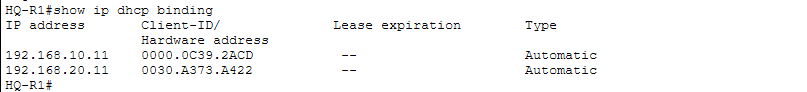

---

## Phase 5: DNS and web server

**Goal:** Reach the server by name from both sites.

**What I configured:** The DNS service on the server with an A record for `www.company.local` pointing to 192.168.10.10, and the HTTP service turned on.

**Verification:**
- From the branch PC, `nslookup` and `ping www.company.local` resolved to 192.168.10.10 across the WAN (TTL 126, meaning two routers in the path).
- From PC-HQ, the browser loaded `http://www.company.local`.

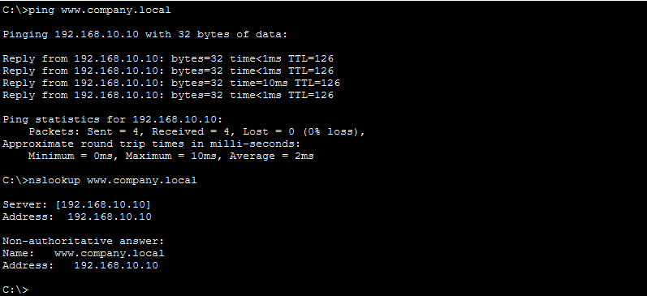
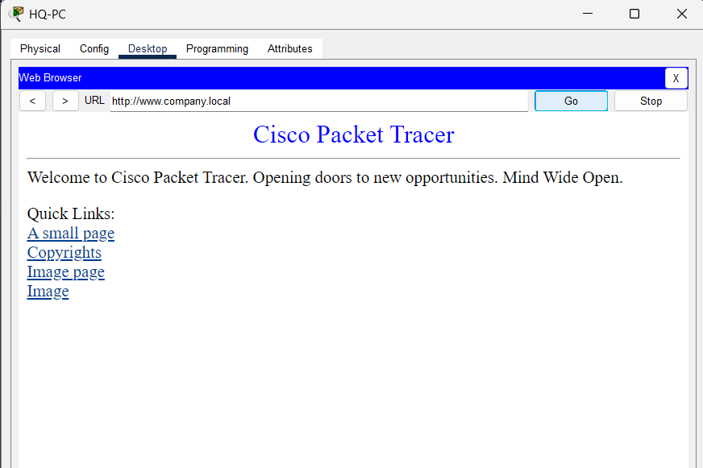

---

## Phase 6: End-to-end connectivity

**Goal:** Confirm traffic flows between the sites through the routers.

**Verification:** `tracert` from PC-HQ to the branch PC shows the path through an HQ router, then BR-R1, then the branch PC.

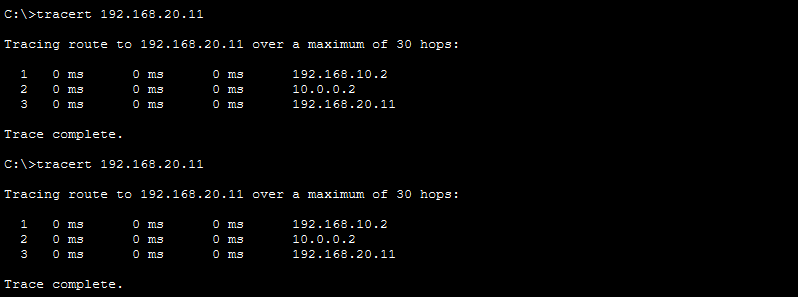

---

## Phase 7: Failover test

**Goal:** Show that the network keeps working when the active HQ router loses its WAN link.

**Steps:**
1. Started a continuous ping from PC-HQ to the branch PC.
2. Confirmed HQ-R1 was Active.
3. Shut down g0/1 on HQ-R1. This is the LAN port that runs HSRP, so HQ-R2 stopped receiving HSRP hellos from HQ-R1 and took over as Active. (This failover came from the HSRP port going down, not from the WAN-port tracking in Phase 3.)
4. Checked HQ-R2, which became Active.
5. Restored the port with `no shutdown`, and HQ-R1 took the Active role back through preempt.

**Observation:** The continuous ping lost 30 replies during the switchover, then continued without any change on the PCs.

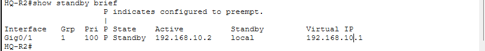
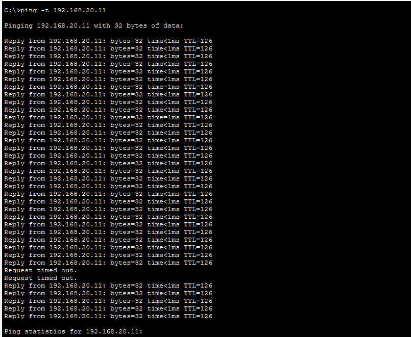(screenshots/12-failover-ping-optional.png)
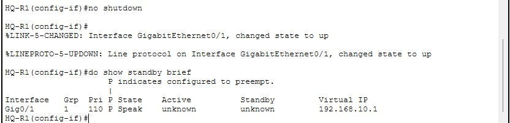

---

## Problems I ran into
- **OSPF stuck in EXSTART:** BR-R1's adjacency with HQ-R1 was stuck at first. It reached FULL after restarting the OSPF process (`clear ip ospf process`).
- **Server could not reply to the branch:** The server needed its default gateway set to the HSRP virtual IP (192.168.10.1). It is under Config > Global Settings in Packet Tracer, not on the interface page.
- **DNS typo:** A lookup failed with "Non-existent domain" because I mistyped the name in the command, not because of a network fault. The server answered correctly for the name it knew.

## Limitations
- DHCP runs only on HQ-R1. If HQ-R1 fails, existing clients keep their leases, but new clients cannot get an address. A fuller design would split the pools across both HQ routers or use a dedicated DHCP server.
- On the branch PC, the Packet Tracer web browser did not display the page by hostname, although `nslookup` and `ping` to the same name succeeded and the page loaded from PC-HQ. I treated this as a simulator browser limitation and verified the branch with `nslookup` and `ping` instead.

## What I learned
- How HSRP gives two routers one shared gateway, and how priority, preempt and tracking decide which router is Active.
- Why a DHCP relay is needed when the DHCP server is on another network, because routers do not forward broadcasts.
- How OSPF builds equal-cost routes over two links, and how to read neighbor states such as EXSTART and FULL.
- How to isolate a problem step by step: check the interface, the route, the gateway, then the service.

## Repository contents

| Item | Description |
|---|---|
| `two-site-network.pkt` | The Packet Tracer file |
| `topology.png` | Network diagram |
| `configs/` | Running configurations of HQ-R1, HQ-R2 and BR-R1 |
| `screenshots/` | Verification and test results |
